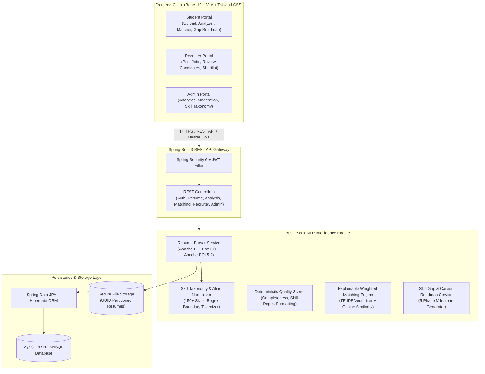
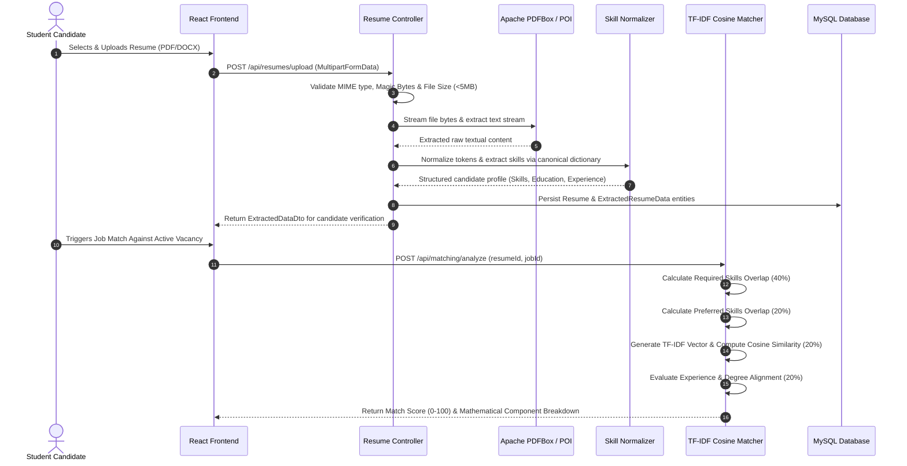

# System Architecture & Technical Specifications

## 1. Overview & System Architecture

**AI-Powered Resume Analyzer and Job Matcher** is a full-stack, enterprise-grade recruitment and career advisory platform. Built with a **Java 21 / Spring Boot 3** core engine and a **React 19 / Vite / Tailwind CSS** client, the system operates completely independently of external paid APIs through pure Java deterministic algorithms while offering extensible hooks for optional generative AI integrations.

---

## 2. Component Pipeline & Sequence Flow

The interaction between the student candidate, the resume parsing engine, and the explainable job matcher follows a synchronized, deterministic flow:

---

## 3. Explainable Job Matching Mathematical Model

Unlike opaque black-box machine learning approaches, the platform implements a fully explainable, mathematically auditable matching formula.

### 3.1 Base Formula

The composite match score $S_{\text{final}}$ is defined as the weighted linear combination:

$$S_{\text{final}} = \sum_{i \in \mathcal{C}} w_i \cdot s_i$$

Where:
- $\mathcal{C}$ is the set of active criteria components:
  1. **Required Skills Overlap** ($s_{\text{req}}$): Weight $w_{\text{req}} = 0.40$ (40%)
  2. **Preferred Skills Overlap** ($s_{\text{pref}}$): Weight $w_{\text{pref}} = 0.20$ (20%)
  3. **Semantic / TF-IDF Text Similarity** ($s_{\text{tfidf}}$): Weight $w_{\text{tfidf}} = 0.20$ (20%)
  4. **Experience Match** ($s_{\text{exp}}$): Weight $w_{\text{exp}} = 0.10$ (10%)
  5. **Education / Degree Match** ($s_{\text{edu}}$): Weight $w_{\text{edu}} = 0.10$ (10%)

### 3.2 Dynamic Weight Redistribution

When an optional requirement is not specified in the job posting (e.g., no preferred skills or no minimum experience specified), the system avoids penalizing the candidate by redistributing the unassigned weight proportionally:

$$w'_i = \frac{w_i}{\sum_{j \in \mathcal{C}_{\text{active}}} w_j}$$

$$\sum_{i \in \mathcal{C}_{\text{active}}} w'_i = 1.0 \quad (100\%)$$

### 3.3 TF-IDF Vectorization & Cosine Similarity

The semantic similarity component $s_{\text{tfidf}}$ processes both the resume text and the job description:

1. **Tokenization & Stopword Pruning**:
   Raw documents are converted to lower-case tokens, stripped of common English grammatical stopwords (articles, prepositions, auxiliary verbs).
2. **Term Frequency ($TF$)**:
   $$TF(t, d) = \frac{f_{t, d}}{\sum_{t' \in d} f_{t', d}}$$
3. **Inverse Document Frequency ($IDF$)**:
   $$IDF(t, D) = \ln\left(1 + \frac{|D|}{1 + |\{d \in D : t \in d\}|}\right)$$
4. **Cosine Similarity**:
   $$\text{Cosine}(\vec{v}_{\text{resume}}, \vec{v}_{\text{job}}) = \frac{\vec{v}_{\text{resume}} \cdot \vec{v}_{\text{job}}}{\|\vec{v}_{\text{resume}}\| \|\vec{v}_{\text{job}}\|} = \frac{\sum_{k=1}^m v_{r, k} v_{j, k}}{\sqrt{\sum_{k=1}^m v_{r, k}^2} \sqrt{\sum_{k=1}^m v_{j, k}^2}}$$
   The resulting value $\in [0, 1]$ is scaled to $[0, 100]$.

---

## 4. NLP Skill Extraction & Alias Normalization

Technical skill extraction utilizes an in-memory dictionary with canonical naming and synonym alias mapping.

### Example Alias Resolution:
- `"SpringBoot"`, `"Spring-Boot"`, `"spring boot"` $\rightarrow$ **Spring Boot**
- `"JS"`, `"javascript"`, `"ecmascript"` $\rightarrow$ **JavaScript**
- `"TS"`, `"typescript"` $\rightarrow$ **TypeScript**
- `"Postgres"`, `"PostgreSQL."`, `"pgsql"` $\rightarrow$ **PostgreSQL**
- `"K8s"`, `"kubernetes"` $\rightarrow$ **Kubernetes**
- `"AWS"`, `"Amazon Web Services"` $\rightarrow$ **AWS**

Boundary-aware regex matching ensures that substring collisions (such as "Java" inside "JavaScript" or "Go" inside "Google") are prevented through word boundaries `\b` and lookaround assertions.

---

## 5. Deterministic Resume Quality Scoring Rubric

The Resume Quality Score (0–100) is deterministically calculated across 7 core quality dimensions:

| Dimension | Points | Evaluation Criteria |
| :--- | :---: | :--- |
| **Completeness** | 20 pts | Presence of Name, Email, Phone, Education, Skills, and Summary sections |
| **Technical Skill Breadth** | 20 pts | Number and diversity of verified technical skills (5+ skills = 10 pts, 10+ skills = 15 pts, 15+ skills = 20 pts) |
| **Education Information** | 15 pts | Stated degree program, graduation year, and academic CGPA/percentage |
| **Experience & Internships** | 15 pts | Quantified action-oriented bullet points, company names, and dates |
| **Project Showcase** | 15 pts | At least 2 applied software projects with technologies specified |
| **Formatting & Length** | 10 pts | Optimal word count (250–1200 words), balanced section structure |
| **Keyword Relevance** | 5 pts | Presence of industry-standard engineering terms (e.g. CI/CD, testing, cloud, git) |

---

## 6. Security Architecture

1. **Authentication**: Stateless JSON Web Tokens (JJWT 0.12.5) signed with HMAC-SHA384.
2. **Password Storage**: Passwords hashed using standard BCrypt with cost factor 10.
3. **Role-Based Access Control (RBAC)**:
   - `STUDENT`: Upload resumes, run analyses, match jobs, view roadmaps, apply for jobs.
   - `RECRUITER`: Create and manage corporate job postings, review applicants, change status.
   - `ADMIN`: View system-wide metrics, suspend/delete users, moderate jobs, manage skill taxonomy.
4. **File Upload Security**:
   - Content-type inspection & magic byte verification.
   - File size restricted to 5 MB.
   - Files stored with randomized UUID filenames outside the web application context root.
