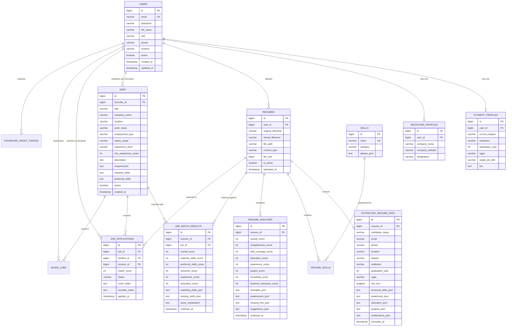

# Database Schema & Entity Relationship Design

## 1. Entity-Relationship (ER) Diagram

---

## 2. Table Specifications & Schema Details

### 2.1 `users`
Stores user identities, hashed passwords, and assigned system roles.
- `id` (BIGINT, Primary Key, Auto-increment)
- `email` (VARCHAR(150), Unique, Not Null, Indexed)
- `password` (VARCHAR(255), Not Null) — BCrypt hash
- `full_name` (VARCHAR(100), Not Null)
- `role` (VARCHAR(20), Not Null) — `STUDENT`, `RECRUITER`, `ADMIN`
- `phone` (VARCHAR(30))
- `location` (VARCHAR(100))
- `active` (BOOLEAN, Default: TRUE)
- `created_at` (TIMESTAMP, Default: CURRENT_TIMESTAMP)
- `updated_at` (TIMESTAMP)

### 2.2 `resumes`
Tracks uploaded resume documents with filesystem storage paths.
- `id` (BIGINT, Primary Key, Auto-increment)
- `user_id` (BIGINT, Foreign Key to `users(id)`, Indexed)
- `original_filename` (VARCHAR(255), Not Null)
- `stored_filename` (VARCHAR(255), Not Null, Unique)
- `file_path` (VARCHAR(500), Not Null)
- `content_type` (VARCHAR(100), Not Null) — `application/pdf`, `application/vnd.openxmlformats-officedocument.wordprocessingml.document`
- `file_size` (BIGINT, Not Null)
- `is_active` (BOOLEAN, Default: TRUE)
- `uploaded_at` (TIMESTAMP, Default: CURRENT_TIMESTAMP)

### 2.3 `extracted_resume_data`
Stores parsed textual data, normalized skills, and section extracts.
- `id` (BIGINT, Primary Key, Auto-increment)
- `resume_id` (BIGINT, Foreign Key to `resumes(id)`, Unique)
- `candidate_name` (VARCHAR(150))
- `email` (VARCHAR(150))
- `phone` (VARCHAR(50))
- `degree` (VARCHAR(150))
- `graduation_year` (INT)
- `cgpa` (VARCHAR(20))
- `raw_text` (LONGTEXT, Not Null)
- `technical_skills` (TEXT) — Comma-separated or JSON array of canonical skills
- `experience_json` (TEXT)
- `education_json` (TEXT)
- `projects_json` (TEXT)
- `certifications_json` (TEXT)
- `extracted_at` (TIMESTAMP, Default: CURRENT_TIMESTAMP)

### 2.4 `jobs`
Maintains corporate job vacancy listings authored by recruiters or seeded as sample engineering openings.
- `id` (BIGINT, Primary Key, Auto-increment)
- `recruiter_id` (BIGINT, Nullable Foreign Key to `users(id)`)
- `title` (VARCHAR(200), Not Null)
- `company_name` (VARCHAR(150), Not Null)
- `location` (VARCHAR(100), Not Null)
- `work_mode` (VARCHAR(20), Not Null) — `REMOTE`, `HYBRID`, `ON_SITE`
- `employment_type` (VARCHAR(30), Not Null) — `FULL_TIME`, `INTERNSHIP`, `CONTRACT`, `PART_TIME`
- `salary_range` (VARCHAR(100))
- `experience_level` (VARCHAR(50))
- `min_experience_years` (INT, Default: 0)
- `description` (TEXT, Not Null)
- `requirements` (TEXT)
- `required_skills` (TEXT, Not Null)
- `preferred_skills` (TEXT)
- `active` (BOOLEAN, Default: TRUE)
- `created_at` (TIMESTAMP, Default: CURRENT_TIMESTAMP)

### 2.5 `job_match_results`
Stores calculated match scores and component weights for auditability and history.
- `id` (BIGINT, Primary Key, Auto-increment)
- `resume_id` (BIGINT, Foreign Key to `resumes(id)`)
- `job_id` (BIGINT, Foreign Key to `jobs(id)`)
- `overall_score` (INT, Not Null) — 0 to 100
- `required_skills_score` (INT)
- `preferred_skills_score` (INT)
- `semantic_score` (INT)
- `experience_score` (INT)
- `education_score` (INT)
- `matching_skills` (TEXT)
- `missing_skills` (TEXT)
- `score_explanation` (TEXT)
- `matched_at` (TIMESTAMP, Default: CURRENT_TIMESTAMP)

### 2.6 `job_applications`
Tracks candidate applications to corporate positions with recruiter decisions.
- `id` (BIGINT, Primary Key, Auto-increment)
- `job_id` (BIGINT, Foreign Key to `jobs(id)`, Composite Unique with `student_id`)
- `student_id` (BIGINT, Foreign Key to `users(id)`)
- `resume_id` (BIGINT, Foreign Key to `resumes(id)`)
- `match_score` (INT, Default: 0)
- `status` (VARCHAR(30), Not Null) — `APPLIED`, `UNDER_REVIEW`, `SHORTLISTED`, `REJECTED`
- `cover_letter` (TEXT)
- `recruiter_notes` (TEXT)
- `applied_at` (TIMESTAMP, Default: CURRENT_TIMESTAMP)

---

## 3. Dual-Profile Database Compatibility

The application is architected to seamlessly transition between local development and production environments without changing entity definitions or application code:

1. **`local` Profile (Default)**:
   - Uses embedded persistent H2 database stored at `./data/resumedb`.
   - Initialized with `MODE=MySQL;DATABASE_TO_LOWER=TRUE;CASE_INSENSITIVE_IDENTIFIERS=TRUE`.
   - Zero installation prerequisites; ensures immediate execution and automated testing.
2. **`mysql` Profile (Production)**:
   - Connects to native MySQL 8.0 server on port `3306`.
   - Uses `org.hibernate.dialect.MySQLDialect`.
   - Automatically builds tables via `spring.jpa.hibernate.ddl-auto: update`.
